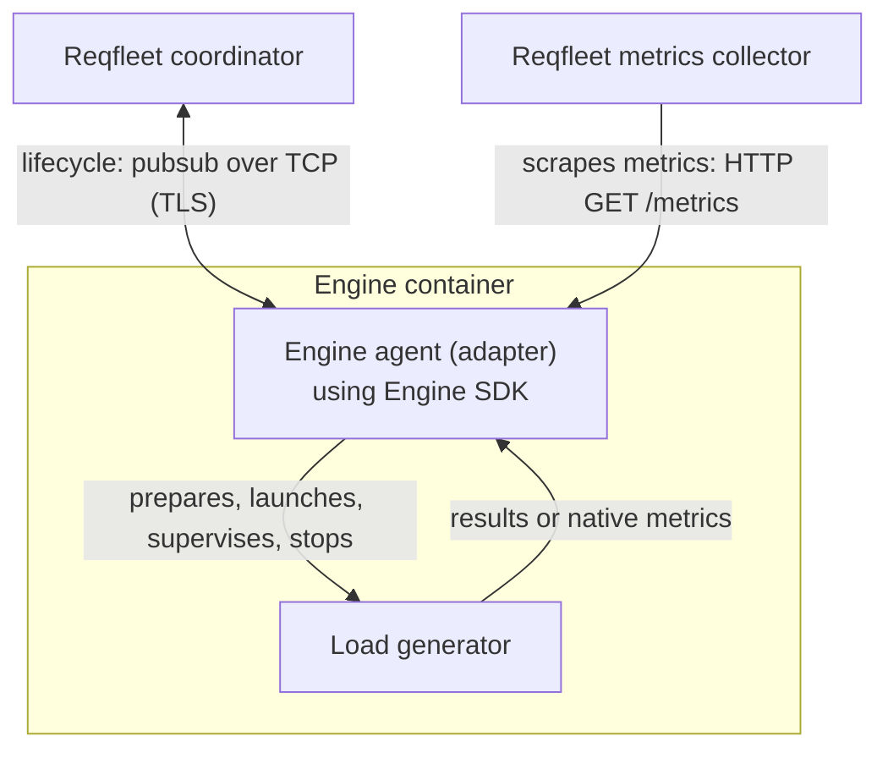

# External engine adapters

Independent, operator-managed engine adapters for Reqfleet Shibuya, built with the public [engine-sdk](https://github.com/reqfleet/engine-sdk). Each adapter translates assigned workload settings into engine-native configuration and maps engine output into Reqfleet metrics. The SDK handles coordinator communication, input downloads and process lifecycle.

- **Private adapters:** JMeter, Locust and Replay; these may be open-sourced in the future.
- **Public adapters:** [k6](k6/README.md).

## Development

- Go for the shared Go module and unit/race tests.
- Docker with **Linux containers** for image builds and container-only conformance tests.
- Public HTTPS access to Go modules, OS packages and the selected engine's release artifacts.

Build and test targets live in each adapter directory; Docker builds use the repository root as their context. See the adapter's README for commands. Run integration binaries only inside their conformance containers, not on the host.

See [AGENTS.md](AGENTS.md) for detailed development, onboarding and release instructions, and the [k6 guide](k6/README.md) for supported plans, settings and metrics.

New adapters reuse the [container conformance suite](AGENTS.md#reusable-adapter-conformance), supplying engine-native fixtures and expected metrics. Run it alongside adapter unit tests for either SDK metrics approach.

### Add an engine with the skill

Open this checkout in an agent that supports repository skills and invoke `develop-new-engine`. If it is not discovered automatically, ask the agent to read and follow [`.agents/skills/develop-new-engine/SKILL.md`](.agents/skills/develop-new-engine/SKILL.md):

> Use develop-new-engine to add an adapter for my engine. Resolve the latest stable engine-sdk release, inspect the engine's output, and discuss request-event parsing versus normalized metrics with me before implementing reporting.

Bring the engine/version, a sample plan and the reports you need. The skill guides SDK integration, metric semantics, verification and Shibuya onboarding.

See [contribution instructions](AGENTS.md#commit-and-open-a-pull-request) for the branch, commit, PR and review workflow.

## Releases

This repository uses [release-please](https://github.com/googleapis/release-please) to manage per-adapter versions, release PRs and changelogs. Adapter images are independently versioned under `ghcr.io/reqfleet/engine-adapters/<adapter>`. See [releases](https://github.com/reqfleet/engine-adapters/releases). Deploy an approved immutable digest with a compatible Shibuya release.

Releasing a new engine kind also requires changes to the Reqfleet control plane (Shibuya), with help from the Reqfleet team. Coordinate admission, UI and deployment configuration changes with them before rollout (a lightweight and fast process); publishing the adapter image alone does not make the engine available.

## Licensing

Adapter code is Apache-2.0; see [LICENSE](LICENSE) and [NOTICE](NOTICE). Bundled engines retain their own licenses; see each adapter's documentation for license and corresponding-source obligations.
